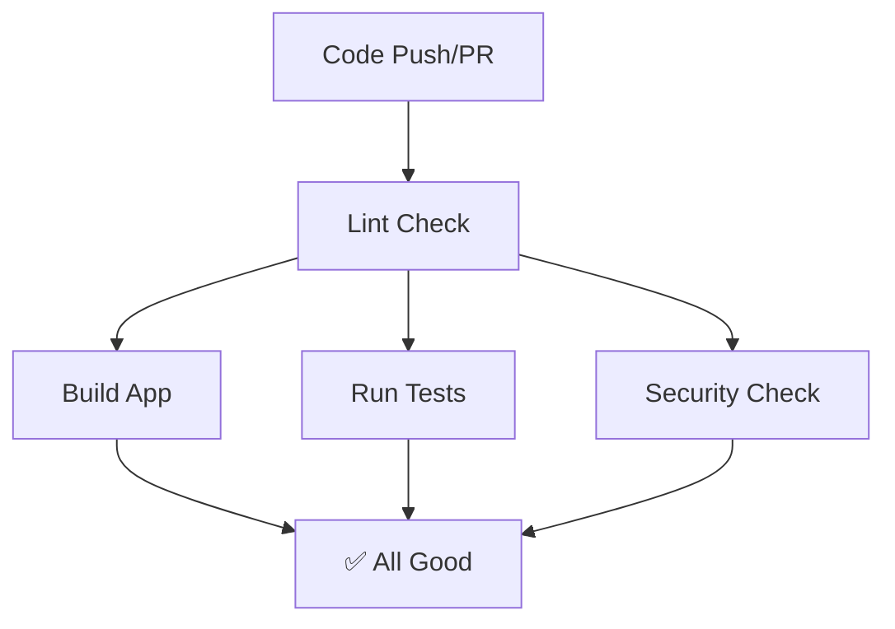

# 🚀 CI/CD Pipeline

## Overview

This project implements an automated CI pipeline using GitHub Actions to ensure code quality, testing, and security for the Music Licensing Workflow application.

## 🏗️ Pipeline Architecture



## 📋 CI Workflow

The pipeline is triggered on:

- Push to `main` or `develop` branches
- Pull requests to `main` or `develop`

The workflow consists of 4 parallel jobs:

### 1. 🧹 Code Quality Check (Lint)

- Runs ESLint to check TypeScript code style
- Runs Prettier to verify formatting
- Uses Node.js 20

### 2. 🏗️ Build Application

- Compiles TypeScript to JavaScript
- Ensures the code can build without errors
- Uses Node.js 20

### 3. 🧪 Run Tests

- Sets up PostgreSQL database automatically
- Runs database migrations
- Executes Jest tests with coverage
- Uses Node.js 20

### 4. 🛡️ Security Check

- Runs `npm audit` to find dependency vulnerabilities
- Checks for moderate+ severity issues
- Continues even if vulnerabilities found (warns but doesn't fail)

## 📁 Files Structure

- `.github/workflows/ci.yml` - Main CI pipeline configuration

## 🎯 Design Decisions

### Scope

This pipeline focuses on essential CI functionality:

- **Code Quality**: Automated linting and formatting checks
- **Build Validation**: TypeScript compilation verification
- **Testing**: Comprehensive test suite with database integration
- **Security**: Basic dependency vulnerability scanning

### Technology Choices

- **GitHub Actions**: Native GitHub integration and ease of use
- **Node.js 20**: Stable LTS version for consistent builds
- **PostgreSQL 15**: Production-like database for testing
- **Jest**: Comprehensive testing framework with coverage reporting

### Excluded Features

The following were intentionally omitted to maintain simplicity:

- Multiple Node.js version testing
- Advanced security scanning tools
- Performance benchmarking
- Docker image building
- Automated dependency updates

## 🧪 Testing Strategy

### Code Quality

```bash
cd backend && npm run lint     # ESLint static analysis
cd backend && npm run format   # Prettier code formatting
```

### Build Validation

```bash
cd backend && npm run build    # TypeScript compilation
```

### Automated Testing

```bash
cd backend && npm run migration:run  # Database schema setup
cd backend && npm run test:cov       # Unit & integration tests with coverage
```

### Security Scanning

```bash
npm audit --audit-level moderate     # Dependency vulnerability analysis
```

## 🚀 Getting Started

### Local Development

The same commands that run in CI can be executed locally:

```bash
# Install dependencies
npm ci && cd backend && npm install

# Run quality checks
cd backend && npm run lint
cd backend && npm run format

# Build the application
cd backend && npm run build

# Run tests (requires PostgreSQL)
cd backend && npm run test:cov

# Security audit
npm audit
```

### Monitoring CI Results

- Check the **Actions** tab in GitHub for pipeline status
- All jobs must pass for pull requests to be mergeable
- Failed builds will prevent code from reaching main branches

## 🔄 Continuous Integration Benefits

This CI pipeline provides:

- **Early bug detection** through automated testing
- **Code quality consistency** via linting and formatting
- **Security awareness** through dependency scanning
- **Build confidence** with compilation verification
- **Team collaboration** through standardized checks
